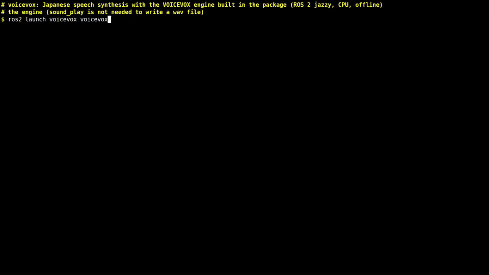

# voicevox

ROS interface for [VOICEVOX](https://voicevox.hiroshiba.jp/), a free Japanese AI speech synthesis engine.
The package builds the VOICEVOX engine (CPU) into the package, and launches it together with
[sound_play](https://github.com/ros-drivers/audio_common) so that Japanese text sent to `robotsound_jp`
is spoken. It can also publish the speech as raw PCM on an audio topic instead, and can use the official
VOICEVOX Docker image (CPU or GPU) or an engine running on another machine.
The same launch arguments and environment variables work on ROS 1 and ROS 2.

## Try it with Docker first

The [official VOICEVOX engine image](https://hub.docker.com/r/voicevox/voicevox_engine) needs no build. Try the voices
with it (CPU image, about 2.7 GB on disk):

```bash
docker run --rm -p 50021:50021 voicevox/voicevox_engine:cpu-ubuntu20.04-latest
# another terminal: synthesize 「こんにちは」 with speaker 3 (ずんだもん-ノーマル), see Speakers
curl -s -X POST --get --data-urlencode 'text=こんにちは' 'localhost:50021/audio_query?speaker=3' > query.json
curl -s -X POST -H 'Content-Type: application/json' -d @query.json 'localhost:50021/synthesis?speaker=3' > voice.wav
```

The nodes of this package can use that engine instead of the one built into the package: `remote_only:=true` starts
no engine and uses the one at `host`:`port` (default `localhost:50021`), and `use_docker:=true` makes the launch file
start the container itself (see [Deployment patterns](#deployment-patterns)):

```bash
ros2 launch voicevox voicevox_texttospeech.launch.xml remote_only:=true   # the container above
ros2 launch voicevox voicevox_texttospeech.launch.xml use_docker:=true    # or: the launch file runs it
ros2 topic pub --once /robotsound_jp/text std_msgs/msg/String "{data: 'こんにちは'}"
```

(ROS 1: `roslaunch voicevox voicevox_texttospeech.launch` with the same arguments.)
The package itself still has to be built (its nodes and the Python client run in its virtualenv), and the build
always downloads the engine, the core and the resources described in [Requirements](#requirements); only the engine
which runs differs.

## Demo



The engine of this package (ROS 2 jazzy, CPU, offline; `ros2 launch voicevox voicevox_texttospeech.launch.xml
launch_sound_play:=false`, as sound_play is not needed for a wav file) writes
「こんにちは。ボイスボックスで音声合成しています。」 to a wav file with `request_synthesis.py` (speaker 3,
ずんだもん-ノーマル), see [Write a wav file without ROS topics](#write-a-wav-file-without-ros-topics).
The speech (VOICEVOX:ずんだもん):

<!-- doc/voicevox_sample.mp4, uploaded to GitHub to play here -->
https://github.com/user-attachments/assets/77a9846b-d935-402b-9c2e-71786f53c7d2

If the video does not play, [listen to the sample](doc/voicevox_sample.mp3) (mp3) or
[download the video](doc/voicevox_sample.mp4).

## Requirements

- x86_64 or aarch64 Linux (on other architectures the package builds nothing).
- Network access at build time. The build downloads:
  - [voicevox_engine](https://github.com/VOICEVOX/voicevox_engine) (git clone, about 10 MB): `0.23.0` with Python >= 3.12
    (ROS 2 jazzy and later, ROS One on noble), `0.14.7` with older Pythons (noetic);
  - [voicevox_core](https://github.com/VOICEVOX/voicevox_core) CPU release zip with the voice models and ONNX Runtime
    (about 1.3 GB for `0.15.7`, about 0.96 GB for `0.14.6`);
  - [voicevox_resource](https://github.com/VOICEVOX/voicevox_resource) (shallow git clone of the character information);
  - the Python packages of the engine, into a virtualenv of the package (ROS 1: catkin_virtualenv with
    `requirements_python3.*.txt`; ROS 2: [uv](https://docs.astral.sh/uv/) with `pyproject.toml`/`uv.lock`),
    and, on ROS 2, the Open JTalk dictionary of pyopenjtalk (about 24 MB).
- No credentials. Check the [terms of use](#terms-of-use) of VOICEVOX and of each character.
- Optional: Docker, and the [NVIDIA Container Toolkit](https://docs.nvidia.com/datacenter/cloud-native/container-toolkit/latest/install-guide.html)
  for `use_gpu:=true`.

## Build

```bash
# ROS 1
catkin build voicevox
# ROS 2
colcon build --packages-up-to voicevox
```

## Usage

### ROS 2

```bash
# engine (CPU, in this package) + sound_play
ros2 launch voicevox voicevox_texttospeech.launch.xml
# speak (from another terminal)
ros2 topic pub --once /robotsound_jp/text std_msgs/msg/String "{data: 'こんにちは。音声テストです。'}"
ros2 topic pub --once /robotsound_jp sound_play_msgs/msg/SoundRequest "{sound: -3, command: 1, volume: 1.0, arg: 'こんにちは', arg2: '四国めたん-あまあま'}"
# list the speakers (needs a running engine)
ros2 run voicevox list_speakers.py
```

### ROS 1

```bash
roslaunch voicevox voicevox_texttospeech.launch
rostopic pub --once /robotsound_jp/text std_msgs/String "data: 'こんにちは'"
rostopic pub --once /robotsound_jp sound_play/SoundRequest "{sound: -3, command: 1, volume: 1.0, arg: 'こんにちは', arg2: '四国めたん-あまあま'}"
rosrun voicevox list_speakers.py
```

In `SoundRequest`, `sound: -3` is `SAY`, `command: 1` is `PLAY_ONCE` and `arg2` is the voice (a speaker id or the
beginning of a speaker name, see [Speakers](#speakers)); an empty `arg2` uses `default_speaker`.

### Deployment patterns

```bash
# A: the engine in this package, CPU only (default)
ros2 launch voicevox voicevox_texttospeech.launch.xml
# B: the engine in the official Docker image (CPU, or GPU with use_gpu:=true), started by the launch file
ros2 launch voicevox voicevox_texttospeech.launch.xml use_docker:=true use_gpu:=true
# C: an engine on another machine
#    server: ros2 launch voicevox voicevox_texttospeech.launch.xml docker_only:=true use_gpu:=true
#        or: docker run --rm --gpus all -p '50021:50021' voicevox/voicevox_engine:nvidia-ubuntu20.04-latest
#    client:
ros2 launch voicevox voicevox_texttospeech.launch.xml host:=<server_ip> port:=50021
```

(ROS 1: `roslaunch voicevox voicevox_texttospeech.launch` with the same arguments.)
The Docker images are `voicevox/voicevox_engine:cpu-ubuntu20.04-latest` and
`voicevox/voicevox_engine:nvidia-ubuntu20.04-latest`; the launch file pulls them if they are missing.
With `use_gpu:=true`, a short synthesis is sent once after the container starts (warm-up), because the first
synthesis can take tens of seconds.

### Publish the speech on an audio topic

With `output_type:=audio`, `request_synthesis.py --output-type audio` (node `voicevox_audio`) runs instead of
sound_play. It speaks the same `robotsound_jp` (`SoundRequest`) and `robotsound_jp/text` (`std_msgs/String`) topics,
and publishes the speech as raw PCM (mono, S16LE, `sample_rate`) on `audio`, to be played by e.g. audio_common's
`audio_play` (`format:=wave`, the same `sample_rate`), possibly on another machine. It also serves the same `robotsound_jp` action as sound_play
(ROS 1: `sound_play/SoundRequestAction`; ROS 2: `sound_play_msgs/action/SoundRequest`),
including `SoundClient(blocking=True)`. Only `SAY` + `PLAY_ONCE` are supported;
`arg` is text, `arg2` is the speaker, and `volume` multiplies `volume_scale`.
Success means all PCM has been published at playback speed, not that a remote speaker
has finished playback. Feedback reports `playing` and elapsed audio duration in `stamp`.
Cancel stops further PCM publication; synthesis already in progress finishes before
cancellation is processed, and audio already buffered downstream cannot be recalled.
ROS 2 rejects additional action goals while one is active; ROS 1 uses normal
SimpleActionServer preemption. Overlapping topic/action speech is not mixed: a busy
request is logged (topics) or aborted (actions).

```bash
ros2 action send_goal /robotsound_jp sound_play_msgs/action/SoundRequest \
  '{sound_request: {sound: -3, command: 1, volume: 1.0, arg: "こんにちは", arg2: "2"}}' --feedback
```

```bash
ros2 launch voicevox voicevox_texttospeech.launch.xml output_type:=audio
ros2 run audio_play audio_play_node --ros-args -p format:=wave -p sample_rate:=16000
# ROS 1
roslaunch voicevox voicevox_texttospeech.launch output_type:=audio volume_scale:=10.0
```

`volume_scale` raises the volume, e.g. about `10.0` for Unitree G1, whose default volume is low.

### Write a wav file without ROS topics

`request_synthesis.py` is also the `text2wave` command of sound_play: it reads the first line of a text file and
writes the speech to a wav file. With an engine running (e.g. the launch file above, or the Docker image):

```bash
echo 'こんにちは。音声テストです。' > /tmp/voicevox.txt
ros2 run voicevox request_synthesis.py -eval 2 -o /tmp/voicevox.wav /tmp/voicevox.txt   # ROS 2
rosrun voicevox request_synthesis.py -eval 2 -o /tmp/voicevox.wav /tmp/voicevox.txt     # ROS 1
```

`-eval` is the speaker (id or name). The results are cached in `$ROS_HOME/voicevox/` (default `~/.ros/voicevox/`)
unless `ROS_VOICEVOX_TEXTTOSPEECH_CACHE_ENABLED` is not `true`.

### Python and roseus

```python
# ROS 1
import rospy
from sound_play.libsoundplay import SoundClient

rospy.init_node('say_node')
client = SoundClient(sound_action='robotsound_jp', sound_topic='robotsound_jp')
client.say('こんにちは', voice='四国めたん-あまあま')
```

```python
# ROS 2
import time

import rclpy
from sound_play.libsoundplay import SoundClient

rclpy.init()
node = rclpy.create_node('say_node')
client = SoundClient(node, sound_action='robotsound_jp', sound_topic='robotsound_jp')
time.sleep(1)
client.say('こんにちは', voice='四国めたん-あまあま')
```

```lisp
;; roseus (ROS 1)
(load "package://pr2eus/speak.l")
(ros::roseus "say_node")
(speak "JSKへようこそ。" :lang "波音リツ" :wait t :topic-name "robotsound_jp")
```

## Interface

### Launch arguments (`voicevox_texttospeech.launch` / `voicevox_texttospeech.launch.xml`)

| Argument | Default | Meaning |
|---|---|---|
| `host` | `$VOICEVOX_TEXTTOSPEECH_URL` or `localhost` | Host of the engine. Other than `localhost`/`127.0.0.1`, no local engine is started |
| `port` | `$VOICEVOX_TEXTTOSPEECH_PORT` or `50021` | Port of the engine |
| `default_speaker` | `$VOICEVOX_DEFAULT_SPEAKER_ID` or `2` | Speaker used when none is given |
| `cpu_num_threads` | `1` | CPU threads of the engine |
| `use_docker` | `false` | Run the engine in the official Docker image instead of the one in this package |
| `docker_only` | `false` | Run only the Docker engine (no sound_play nor ROS nodes), e.g. on a server |
| `use_gpu` | `false` | Use the GPU (`nvidia-ubuntu20.04-latest`) image with `use_docker`/`docker_only` |
| `remote_only` | `false` | Do not start a local engine |
| `output_type` | `wav` | `wav`: play with sound_play. `audio`: publish PCM on `audio` |
| `sample_rate` | `16000` | Sample rate of `audio` (`output_type:=audio`) |
| `volume_scale` | `1.0` | Volume of `audio` (`output_type:=audio`) |
| `launch_sound_play` | `true` | Launch `sound_play_jp` and `text_to_sound_request_jp` (`output_type:=wav`) |
| `sound_play_respawn` | `true` | Respawn the nodes |
| `device` | `""` | Audio output device of sound_play |
| `use_plugin` | `false` | ROS 1: synthesize in `sound_play_jp` with the `voicevox/voicevox_plugin` sound_play plugin |

### Nodes

- `voicevox_server` (`run-voicevox`): the VOICEVOX engine (HTTP server on `0.0.0.0:<port>`).
- `voicevox_docker_server` (`run-voicevox-docker`): the engine in Docker (container `voicevox-engine-<port>`), or,
  for a remote `host`, waits for and monitors it.
- `sound_play_jp` (sound_play's `soundplay_node.py`), `output_type:=wav`: action server and subscriber
  `robotsound_jp` (`sound_play/SoundRequest`; ROS 2: `sound_play_msgs/msg/SoundRequest`, action
  `sound_play_msgs/action/SoundRequest`). It synthesizes `SAY` requests with `bin/text2wave` of this package,
  or, with `use_plugin:=true`, inside the node without starting `text2wave` for each utterance.
- `text_to_sound_request_jp` (`text_to_sound_request.py`), `output_type:=wav`
  - Subscribes `robotsound_jp/text` (`std_msgs/String`), publishes `robotsound_jp` (`SoundRequest`, `SAY`).
  - Parameter `~speaker` (id or name, default `""`: `default_speaker`), read for each message.
- `voicevox_audio` (`request_synthesis.py --output-type audio`), `output_type:=audio`
  - Subscribes `robotsound_jp/text` (`std_msgs/String`) and `robotsound_jp` (`SoundRequest`, only `SAY` +
    `PLAY_ONCE`, `arg2` is the speaker).
  - Serves `robotsound_jp` (`SoundRequest` action) for `SAY` + `PLAY_ONCE`.
  - Publishes `audio` (`audio_common_msgs/AudioData`, mono S16LE in 0.1 s chunks at playback speed) and
    `audio_info` (`audio_common_msgs/AudioInfo`, latched).
  - Parameters: `~speaker` (`default_speaker`, read for each message, can be changed at runtime),
    `~sample_rate` (int, `16000`), `~volume_scale` (float, `1.0`).

### Environment variables

| Variable | Default | Meaning |
|---|---|---|
| `VOICEVOX_TEXTTOSPEECH_URL` | `localhost` | Host of the engine |
| `VOICEVOX_TEXTTOSPEECH_PORT` | `50021` | Port of the engine |
| `VOICEVOX_DEFAULT_SPEAKER_ID` | `2` | Default speaker |
| `VOICEVOX_STARTUP_TIMEOUT` | `300` | Seconds to wait for the engine to start |
| `ROS_VOICEVOX_TEXTTOSPEECH_CACHE_ENABLED` | `true` | Cache the synthesized wav files in `$ROS_HOME/voicevox/` |

The speaker list of the engine is cached in `$ROS_HOME/voicevox/speakers.json`; remove it after changing the engine.

<a id="speakers"></a>
## Speakers

A speaker is given by its id or by (the beginning of) its name, `<character>-<style>`.
`list_speakers.py` prints those of the running engine; the list below may differ with the engine version.

|  speaker_id  |  voice_name  |
| ---- | ---- |
| 0 | 四国めたん-あまあま |
| 1 | ずんだもん-あまあま |
| 2 | 四国めたん-ノーマル |
| 3 | ずんだもん-ノーマル |
| 4 | 四国めたん-セクシー |
| 5 | ずんだもん-セクシー |
| 6 | 四国めたん-ツンツン |
| 7 | ずんだもん-ツンツン |
| 8 | 春日部つむぎ-ノーマル |
| 9 | 波音リツ-ノーマル |
| 10 | 雨晴はう-ノーマル |
| 11 | 玄野武宏-ノーマル |
| 12 | 白上虎太郎-ふつう |
| 13 | 青山龍星-ノーマル |
| 14 | 冥鳴ひまり-ノーマル |
| 15 | 九州そら-あまあま |
| 16 | 九州そら-ノーマル |
| 17 | 九州そら-セクシー |
| 18 | 九州そら-ツンツン |
| 19 | 九州そら-ささやき |
| 20 | もち子さん-ノーマル |
| 21 | 剣崎雌雄-ノーマル |
| 22 | ずんだもん-ささやき |
| 23 | WhiteCUL-ノーマル |
| 24 | WhiteCUL-たのしい |
| 25 | WhiteCUL-かなしい |
| 26 | WhiteCUL-びえーん |
| 27 | 後鬼-人間ver. |
| 28 | 後鬼-ぬいぐるみver. |
| 29 | No.7-ノーマル |
| 30 | No.7-アナウンス |
| 31 | No.7-読み聞かせ |
| 32 | 白上虎太郎-わーい |
| 33 | 白上虎太郎-びくびく |
| 34 | 白上虎太郎-おこ |
| 35 | 白上虎太郎-びえーん |
| 36 | 四国めたん-ささやき |
| 37 | 四国めたん-ヒソヒソ |
| 38 | ずんだもん-ヒソヒソ |
| 39 | 玄野武宏-喜び |
| 40 | 玄野武宏-ツンギレ |
| 41 | 玄野武宏-悲しみ |
| 42 | ちび式じい-ノーマル |
| 43 | 櫻歌ミコ-ノーマル |
| 44 | 櫻歌ミコ-第二形態 |
| 45 | 櫻歌ミコ-ロリ |
| 46 | 小夜/SAYO-ノーマル |
| 47 | ナースロボ＿タイプＴ-ノーマル |
| 48 | ナースロボ＿タイプＴ-楽々 |
| 49 | ナースロボ＿タイプＴ-恐怖 |
| 50 | ナースロボ＿タイプＴ-内緒話 |
| 51 | †聖騎士 紅桜†-ノーマル |
| 52 | 雀松朱司-ノーマル |
| 53 | 麒ヶ島宗麟-ノーマル |
| 54 | 春歌ナナ-ノーマル |
| 55 | 猫使アル-ノーマル |
| 56 | 猫使アル-おちつき |
| 57 | 猫使アル-うきうき |
| 58 | 猫使ビィ-ノーマル |
| 59 | 猫使ビィ-おちつき |
| 60 | 猫使ビィ-人見知り |
| 61 | 中国うさぎ-ノーマル |
| 62 | 中国うさぎ-おどろき |
| 63 | 中国うさぎ-こわがり |
| 64 | 中国うさぎ-へろへろ |
| 65 | 波音リツ-クイーン |
| 66 | もち子さん-セクシー／あん子 |
| 67 | 栗田まろん-ノーマル |
| 68 | あいえるたん-ノーマル |
| 69 | 満別花丸-ノーマル |
| 70 | 満別花丸-元気 |
| 71 | 満別花丸-ささやき |
| 72 | 満別花丸-ぶりっ子 |
| 73 | 満別花丸-ボーイ |
| 74 | 琴詠ニア-ノーマル |
| 75 | ずんだもん-ヘロヘロ |
| 76 | ずんだもん-なみだめ |
| 77 | もち子さん-泣き |
| 78 | もち子さん-怒り |
| 79 | もち子さん-喜び |
| 80 | もち子さん-のんびり |
| 81 | 青山龍星-熱血 |
| 82 | 青山龍星-不機嫌 |
| 83 | 青山龍星-喜び |
| 84 | 青山龍星-しっとり |
| 85 | 青山龍星-かなしみ |
| 86 | 青山龍星-囁き |

<a id="terms-of-use"></a>
## Terms of use

[VOICEVOX](https://voicevox.hiroshiba.jp/) is basically free to use, but please check the terms of use below.

[Terms of use](https://voicevox.hiroshiba.jp/term)

Each voice synthesis character has its own rules. Please use this package according to those terms.

| Character name  |  term link |
| ---- | ---- |
| 四国めたん | https://zunko.jp/con_ongen_kiyaku.html |
| ずんだもん | https://zunko.jp/con_ongen_kiyaku.html |
| 春日部つむぎ | https://tsukushinyoki10.wixsite.com/ktsumugiofficial/利用規約 |
| 波音リツ | http://canon-voice.com/kiyaku.html |
| 雨晴はう | https://amehau.com/?page_id=225 |
| 玄野武宏 | https://virvoxproject.wixsite.com/official/voicevoxの利用規約 |
| 白上虎太郎 | https://virvoxproject.wixsite.com/official/voicevoxの利用規約 |
| 青山龍星 | https://virvoxproject.wixsite.com/official/voicevoxの利用規約 |
| 冥鳴ひまり | https://kotoran8zunzun.wixsite.com/my-site/利用規約 |
| 九州そら | https://zunko.jp/con_ongen_kiyaku.html |
| もち子さん | https://vtubermochio.wixsite.com/mochizora/利用規約 |
| 剣崎雌雄 | https://frontier.creatia.cc/fanclubs/413/posts/4507 |
| WhiteCUL | https://www.whitecul.com/guideline |
| 後鬼 | https://ついなちゃん.com/voicevox_terms/ |
| No.7 | https://voiceseven.com/#j0200 |
| ちび式じい | https://docs.google.com/presentation/d/1AcD8zXkfzKFf2ertHwWRwJuQXjNnijMxhz7AJzEkaI4 |
| 櫻歌ミコ | https://voicevox35miko.studio.site/rule |
| 小夜/SAYO | https://316soramegu.wixsite.com/sayo-official/guideline |
| ナースロボ＿タイプＴ | https://www.krnr.top/rules |
| †聖騎士 紅桜† | https://commons.nicovideo.jp/material/nc296132 |
| 雀松朱司 | https://virvoxproject.wixsite.com/official/voicevoxの利用規約 |
| 麒ヶ島宗麟 | https://virvoxproject.wixsite.com/official/voicevoxの利用規約 |
| 春歌ナナ | https://nanahira.jp/haruka_nana/guideline.html |
| 猫使アル | https://nekotukarb.wixsite.com/nekonohako/利用規約 |
| 猫使ビィ | https://nekotukarb.wixsite.com/nekonohako/利用規約 |
| 中国うさぎ | https://zunko.jp/con_ongen_kiyaku.html |
| 栗田まろん | https://aivoice.jp/character/maron/ |
| あいえるたん | https://www.infiniteloop.co.jp/special/iltan/terms/ |
| 満別花丸 | https://100hanamaru.wixsite.com/manbetsu-hanamaru/rule |
| 琴詠ニア | https://commons.nicovideo.jp/works/nc315435 |
| Voidoll | https://blog.nicovideo.jp/niconews/224589.html |
| 中部つるぎ | https://zunko.jp/con_ongen_kiyaku.html |
| ぞん子 | https://zonko.zone-energy.jp/guideline |
