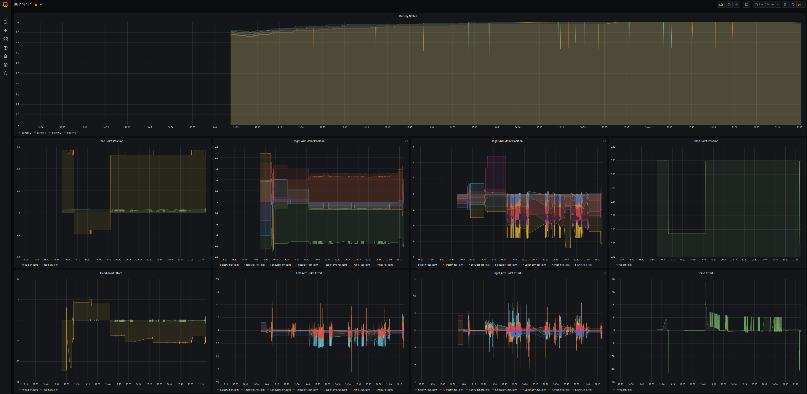
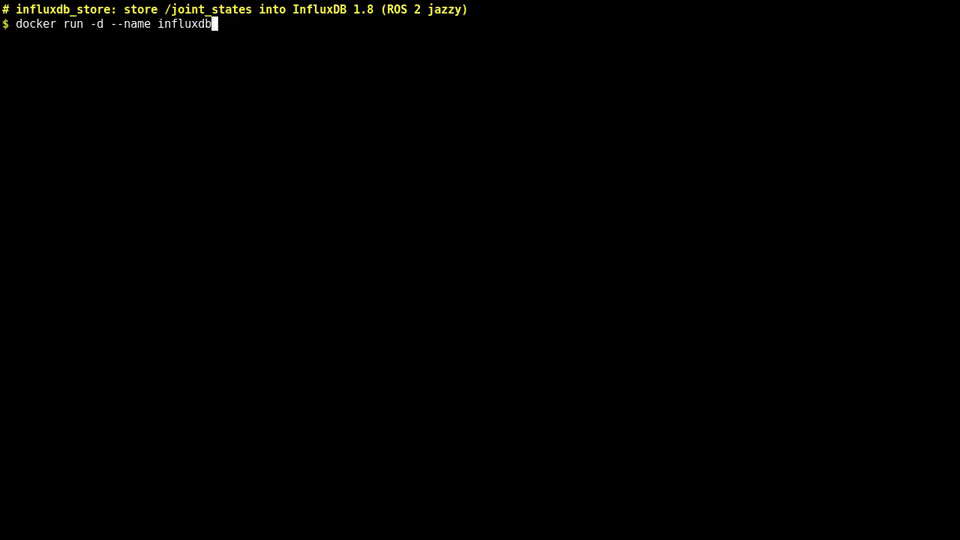

# influxdb_store

Loggers which store ROS topics and TF into [InfluxDB](https://www.influxdata.com/) (1.x), to be browsed with e.g.
[Grafana](https://grafana.com/).



| Node | ROS 1 | ROS 2 | What it stores |
|---|:---:|:---:|---|
| [`joint_states_logger.py`](#joint_states_loggerpy) | ✓ | ✓ | `sensor_msgs/JointState` (position, velocity, effort) |
| [`network_states_logger.py`](#network_states_loggerpy) | ✓ | ✓ | Transmitted and received bps (`std_msgs/Float32`) |
| [`map_transform_logger.py`](#map_transform_loggerpy--base_transform_loggerpy) | ✓ | | All TF frames relative to `map` |
| [`base_transform_logger.py`](#map_transform_loggerpy--base_transform_loggerpy) | ✓ | | All TF frames relative to `base_link` |
| [`pr2_battery_states_logger.py`](#pr2_battery_states_loggerpy) | ✓ | | PR2 batteries (`pr2_msgs/BatteryServer2`) |
| [`fetch_battery_states_logger.py`](#fetch_battery_states_loggerpy) | ✓ | | Fetch battery (`power_msgs/BatteryState`) |

The transform loggers use the `tf2_frames` service of the ROS 1 `tf2_ros` buffer server, and the battery loggers
the messages of PR2 / Fetch, so they are on ROS 1 only. There are no ROS 2 launch files: run the nodes with
`ros2 run`.

## Requirements

An InfluxDB **1.x** server (e.g. 1.8). The nodes use the 1.x Python client (`python3-influxdb`, `InfluxDBClient`)
without authentication, and create the database (`~database`) if it does not exist; InfluxDB 2.x and later are
not supported. For a local test server:

```bash
docker run -d --name influxdb -p 8086:8086 influxdb:1.8
```

## Usage

### ROS 2

```bash
docker run -d --name influxdb -p 8086:8086 influxdb:1.8
# joint states to store (or a robot / joint_state_publisher); start it first, as
# joint_states_logger.py exits when no message comes in a period of ~duration (3 s)
ros2 topic pub -r 10 /joint_states sensor_msgs/msg/JointState \
  '{header: {stamp: now}, name: [joint1], position: [0.5], velocity: [0.0], effort: [0.1]}'
# another terminal
ros2 run influxdb_store joint_states_logger.py --ros-args \
  -r '~/input:=/joint_states' -p host:=localhost -p port:=8086 -p database:=test
# the stored data
docker exec influxdb influx -database test -execute 'SELECT * FROM joint_states ORDER BY time DESC LIMIT 6'
```



(In the recording, the container is named `influxdb_demo`, the output of `ros2 topic pub` is discarded with
`> /dev/null`, and `influx -precision rfc3339` prints the time as a date.)

```bash
ros2 run influxdb_store network_states_logger.py --ros-args \
  -r '~/input/transmit:=/wlan0/transmit' -r '~/input/receive:=/wlan0/receive' -p database:=test
```

### ROS 1

`launch/influxdb_logger.launch` starts the joint states, map transform, base transform and network states loggers;
`host`, `port` and `database` have no default and must be given:

```bash
roslaunch influxdb_store influxdb_logger.launch host:=localhost port:=8086 database:=test
```

| Argument | Default | |
|---|---|---|
| `host`, `port`, `database` | (required) | InfluxDB server and database |
| `launch_joint_states_logger` | `true` | Run `joint_states_logger.py` (`required="true"`) |
| `launch_map_transform_logger` | `true` | Run `map_transform_logger.py` |
| `launch_base_transform_logger` | `true` | Run `base_transform_logger.py` |
| `launch_network_states_logger` | `true` | Run `network_states_logger.py` |
| `joint_states_topic` | `/joint_states` | Input of `joint_states_logger.py` |
| `map_frame_id` | `map` | `~frame_id` of `map_transform_logger.py` |
| `base_frame_id` | `base_link` | `~frame_id` of `base_transform_logger.py` |
| `network_states_transmit_topic` | `/<database>/wlan0/transmit` | Input of `network_states_logger.py` |
| `network_states_receive_topic` | `/<database>/wlan0/receive` | Input of `network_states_logger.py` |

`launch/pr2_battery_logger.launch` and `launch/fetch_battery_logger.launch` (arguments `host`, `port`, `database`,
`battery_states_topic`, all required) run the battery loggers.

Single nodes:

```bash
rosrun influxdb_store joint_states_logger.py ~input:=/joint_states _database:=test
rostopic pub -r 10 -s /joint_states sensor_msgs/JointState \
  '{header: {stamp: now}, name: [joint1], position: [0.5], velocity: [0.0], effort: [0.1]}'
```

#### For JSK robot users

The launch files in `sample/` take `robot_name` (the database name, by default) and the topics of each robot
(`host` defaults to `localhost`, `port` to `8086`):

```bash
rossetip
rossetmaster pr1040   # or pr1012, fetch15, fetch1075, baxter
roslaunch influxdb_store pr2_influxdb_logger.launch robot_name:=pr1040      # PR1012, PR1040
roslaunch influxdb_store fetch_influxdb_logger.launch robot_name:=fetch15   # Fetch15, Fetch1075
roslaunch influxdb_store baxter_influxdb_logger.launch robot_name:=baxter   # Baxter
```

The systemd units in `systemd/` and the scripts in `scripts/` run them as services; see also
[jsk_database](https://github.com/knorth55/jsk_database).

## Interface

All nodes take these parameters:

| Parameter | Type | Default | |
|---|---|---|---|
| `~host` | string | `localhost` | InfluxDB host |
| `~port` | int | `8086` | InfluxDB port |
| `~database` | string | `test` | InfluxDB database, created if it does not exist |

The time of each point is the header stamp of the message where it has one (`joint_states_logger.py`,
`pr2_battery_states_logger.py`), otherwise the current ROS time.

### `joint_states_logger.py`

Subscribed topics:

- `~input` (`sensor_msgs/JointState`): measurement `joint_states`, one point per message for each of the tags
  `type=position`, `type=velocity` and `type=effort`, with a field per joint name.

Parameters:

- `~duration` (double, default `3.0`): period [s] of writing the buffered points. If no message comes in a
  period, the timer callback calls `sys.exit(1)`: on ROS 2 the node exits; on ROS 1 only the rospy timer thread
  ends, so the node stays alive but stops writing. Keep the input topic published, or restart the node.

### `network_states_logger.py`

Stores the bandwidth published by
[`jsk_network_tools/network_status.py`](https://github.com/jsk-ros-pkg/jsk_common/tree/master/jsk_network_tools).

Subscribed topics:

- `~input/transmit` (`std_msgs/Float32`): measurement `network_states`, tag `type=transmit`, field `bps`
- `~input/receive` (`std_msgs/Float32`): measurement `network_states`, tag `type=receive`, field `bps`

### `map_transform_logger.py` / `base_transform_logger.py`

(ROS 1 only) Store the transforms of all the TF frames relative to `~frame_id`: tags `type`
(`translation`/`rotation`), `field` (`x`, `y`, `z`, `w`, `theta`) and `frame_id`, a field per child frame.

Services called:

- `~tf2_frames` (`tf2_msgs/FrameGraph`): the list of frames, from a `tf2_ros` buffer server. The node waits for it
  at start up.

Parameters:

| Parameter | Type | Default | |
|---|---|---|---|
| `~frame_id` | string | `map` / `base_link` | Reference frame |
| `~measurement_name` | string | `map_transform` / `base_transform` | Measurement name |
| `~update_frequency` | double | `30.0` | Rate [Hz] of looking up the transforms |
| `~duration` | double | `3.0` | Period [s] of writing the buffered points |
| `~graph_duration` | double | `60.0` | Period [s] of updating the list of frames |

### `pr2_battery_states_logger.py`

(ROS 1 only) Subscribed topics:

- `~input` (`pr2_msgs/BatteryServer2`): measurement `battery_states`, tag `battery_id`, fields of the average and
  each of the four batteries: `temperature`, `voltage`, `current`, `charge_percent`.

### `fetch_battery_states_logger.py`

(ROS 1 only) Subscribed topics:

- `~input` (`power_msgs/BatteryState`): measurement `battery_states`, tag `battery_name`, field `charge_percent`.
