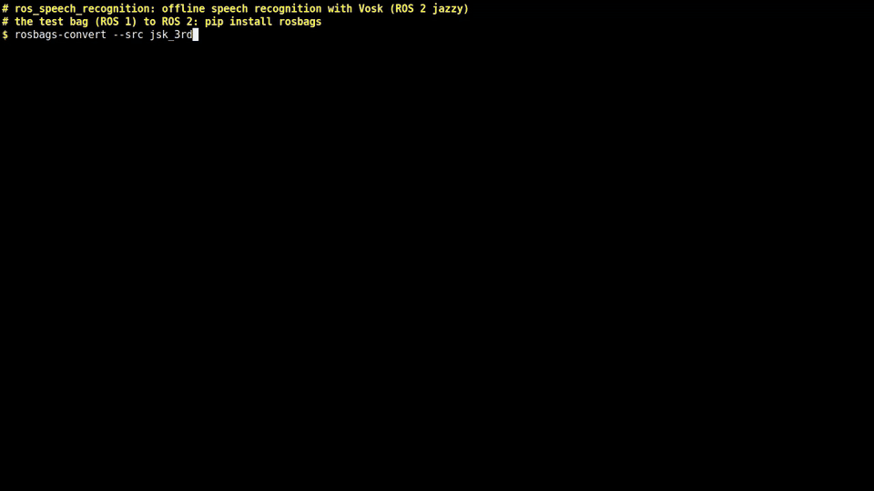

# ros\_speech\_recognition

A ROS package for speech-to-text. `speech_recognition_node.py` listens to an audio topic (e.g. from a microphone
through audio_capture), cuts it into phrases by the audio energy, and recognizes them with one of the engines of the
Python package [SpeechRecognition](https://pypi.python.org/pypi/SpeechRecognition): the Google Web Speech API, Google
Cloud Speech-to-Text (also in streaming), the offline [Vosk](https://alphacephei.com/vosk/), and others. The result is
published on a topic (continuous mode) or returned by a service. The same nodes and launch arguments work on ROS 1 and
ROS 2.

## Requirements

- A microphone (with `audio_capture`), or any `audio_common_msgs/AudioData` topic.
- Per engine (`engine:=...`):
  - `Google` (default): internet access; no key is needed (a public key of SpeechRecognition, which may be blocked;
    `~google_key` sets an own key).
  - `GoogleCloud`, `GoogleCloudStream`: a Google Cloud project with the Speech-to-Text API enabled and the JSON key of a
    service account. Give its path by `google_cloud_credentials_json:=/path/to/key.json`, or set
    `GOOGLE_APPLICATION_CREDENTIALS`. For JSK users, the key is on
    [Google Drive](https://drive.google.com/file/d/1VxniytpH9J12ii9jphtBylydY1_k5nXf/view?usp=sharing).
  - `Vosk`: offline, no credentials. The small English (`vosk-model-small-en-us-0.15`) and Japanese
    (`vosk-model-small-ja-0.22`) models are downloaded into `trained_data/` of the package at build time (ROS 1) or
    install time (ROS 2) with jsk_data (about 40 MB and 48 MB).
  - `Sphinx`, `Wit`, `Bing`, `Houndify`, `IBM`: see SpeechRecognition; `Bing` needs `~bing_key`.
- SpeechRecognition, vosk and google-cloud-speech are installed into a virtualenv of the package at build time
  (ROS 1: catkin_virtualenv with `requirements.txt`; ROS 2: [uv](https://docs.astral.sh/uv/) with
  `pyproject.toml`/`uv.lock`).

## Usage

### ROS 2

```bash
ros2 launch ros_speech_recognition speech_recognition.launch.xml
ros2 topic echo /speech_to_text
# Japanese
ros2 launch ros_speech_recognition speech_recognition.launch.xml language:=ja-JP
# offline with Vosk (language en-US or ja for the bundled models)
ros2 launch ros_speech_recognition speech_recognition.launch.xml engine:=Vosk language:=ja
# Google Cloud, streaming
ros2 launch ros_speech_recognition speech_recognition.launch.xml engine:=GoogleCloudStream language:=ja-JP \
    google_cloud_credentials_json:=/path/to/key.json
# change an engine parameter at runtime (instead of dynamic_reconfigure)
ros2 param set /speech_recognition language ja-JP
# stop and start the recognition (continuous mode)
ros2 service call /speech_recognition/stop std_srvs/srv/Empty
ros2 service call /speech_recognition/start std_srvs/srv/Empty
```

Service mode (`continuous:=false`):

```bash
ros2 launch ros_speech_recognition speech_recognition.launch.xml continuous:=false
ros2 service call /speech_recognition speech_recognition_msgs/srv/SpeechRecognition "{duration: 5.0, quiet: false}"
```

Without a microphone, e.g. with the test bag `test/data/konnichiwa.bag` (ROS 1; convert it with
[rosbags](https://pypi.org/project/rosbags/), `pip install rosbags`). Its audio messages are about 50 KB each, larger
than the default `~buffer_size`, which is not an argument of the launch file, so run the node:

```bash
rosbags-convert --src test/data/konnichiwa.bag --dst konnichiwa
ros2 run ros_speech_recognition speech_recognition_node.py --ros-args -r __node:=speech_recognition \
    -p engine:=Vosk -p language:=ja -p audio_topic:=/speech_audio -p continuous:=true \
    -p enable_sound_effect:=false -p buffer_size:=200000
ros2 topic echo /speech_to_text speech_recognition_msgs/msg/SpeechRecognitionCandidates
ros2 bag play --loop konnichiwa
```



Parrot (repeats what it hears with sound_play):

```bash
ros2 launch ros_speech_recognition parrotry.launch.xml
ros2 launch ros_speech_recognition parrotry.launch.xml engine:=Vosk language:=ja
```

### ROS 1

```bash
roslaunch ros_speech_recognition speech_recognition.launch
rostopic echo /speech_to_text
rosservice call /speech_recognition/stop
rosrun rqt_reconfigure rqt_reconfigure   # engine parameters
# parrot (English: sound_play; ja-JP: aques_talk; use_google:=false: julius_ros)
roslaunch ros_speech_recognition parrotry.launch
roslaunch ros_speech_recognition parrotry.launch language:=ja-JP
```

`ros_speech_recognition.client.SpeechRecognitionClient` (ROS 1 only) wraps the service and dynamic_reconfigure:

```python
from ros_speech_recognition.client import SpeechRecognitionClient
client = SpeechRecognitionClient()   # needs continuous:=false
client.language = 'ja-JP'
print(client.recognize(duration=5.0).transcript)
```

### Streaming recognition with Google Cloud (`GoogleCloudStream`)

In addition to the request/response `GoogleCloud` engine, `GoogleCloudStream` uses the bidirectional gRPC
`StreamingRecognize` API. It publishes interim hypotheses on `~voice_interim_topic` while the user is still speaking,
then the final utterance on `~voice_topic` as usual.

- Endpointing combines Google's own `is_final` flag with a stability timer, `~google_cloud_endpoint_stable_s`
  (default: 1.0 s).
- The gRPC session has a 305 s server-side limit; the recognizer reconnects lazily on the next audio chunk.
- With `~self_cancellation`, the streaming session is closed while a `~tts_action_names` action is active and
  reopened afterwards, not to recognize the robot's own voice.

`Interim:` shows intermediate results, `Result:` the final result after the speaker finishes speaking:

```
[INFO] [1792069200.711352]: Interim: こんにちは。
[INFO] [1792069201.701424]: Result: こんにちは。
[INFO] [1792069218.021376]: Interim: 今日？
[INFO] [1792069218.196229]: Interim:  今日は！
[INFO] [1792069218.621582]: Interim: 今日はいい？
[INFO] [1792069218.710931]: Interim: 今日はいい天気。
[INFO] [1792069219.011066]: Interim: 今日はいい天気です。
[INFO] [1792069219.221464]: Interim: 今日はいい天気ですね。
[INFO] [1792069219.911446]: Interim: 今日はいい天気ですね。外
[INFO] [1792069220.090884]: Interim: 今日はいい天気ですね。外で。
[INFO] [1792069220.211304]: Interim: 今日はいい天気ですね。外で遊び。
[INFO] [1792069220.510955]: Interim: 今日はいい天気ですね。外で遊びませ。
[INFO] [1792069220.595351]: Interim: 今日はいい天気ですね。外で遊びません。
[INFO] [1792069220.814139]: Interim: 今日はいい天気ですね。外で遊びませんか？
[INFO] [1792069221.795355]: Result: 今日はいい天気ですね。外で遊びませんか？
[INFO] [1792069237.912371]: Interim:  ぜひ！
[INFO] [1792069238.089007]: Interim:  ぜひ 外！
[INFO] [1792069238.422502]: Interim:  ぜひ 外で！
[INFO] [1792069238.596863]: Interim:  ぜひ 外で遊び！
[INFO] [1792069238.691785]: Interim:  外で遊び！
[INFO] [1792069238.900729]: Interim: ぜひ 外で遊びましょう。
[INFO] [1792069239.021404]: Interim:  外で遊びましょう。
[INFO] [1792069239.503002]: Interim: ぜひ 外で遊びましょう。
[INFO] [1792069240.221812]: Result: ぜひ 外で遊びましょう。
```

## Launch files

### `speech_recognition.launch` / `speech_recognition.launch.xml`

Launches `sound_play`, `audio_capture` (microphone), `speech_recognition` and `speech_recognition_candidates_to_string`.

| Argument | Default | Meaning |
|---|---|---|
| `launch_sound_play` | `true` | Launch sound_play (action `sound_play`) and play sound effects (`~enable_sound_effect`) |
| `launch_audio_capture` | `true` | Launch audio_capture to publish the microphone on `audio_topic` |
| `audio_topic` | `/audio` | Audio topic |
| `voice_topic` | `/speech_to_text` | Topic of the results |
| `n_channel` | `1` | Channels of the audio |
| `depth` | `16` | Bit depth of the audio |
| `sample_rate` | `16000` | Sample rate of the audio |
| `device` | `""` | Microphone of audio_capture, e.g. `hw:0,0` (see `arecord -l`) |
| `engine` | `Google` | Engine: `Google`, `GoogleCloud`, `GoogleCloudStream`, `Sphinx`, `Wit`, `Bing`, `Houndify`, `IBM`, `Vosk` |
| `language` | `en-US` | Language, e.g. `ja-JP` (also for Vosk) |
| `continuous` | `true` | `true`: publish on `voice_topic`. `false`: serve the `speech_recognition` service |
| `auto_start` | `true` | Start recognizing at launch (continuous mode) |
| `energy_threshold` | `300.0` | Minimum audio energy of speech |
| `dynamic_energy_threshold` | `true` | Adapt `energy_threshold` to the background noise |
| `self_cancellation` | `true` | Ignore the audio while the robot speaks |
| `tts_tolerance` | `1.0` | Seconds after speaking during which the audio is still ignored |
| `tts_action_names` | `['sound_play']` | Actions of text-to-speech for self cancellation |
| `google_cloud_credentials_json` | `""` | Path of the JSON key of Google Cloud |

### `parrotry.launch` / `parrotry.launch.xml`

`speech_recognition.launch(.xml)` (continuous, `voice_topic:=/speech_to_text`, with the microphone) and `parrot_node`,
which says the recognized text.

| Argument | Default | Meaning |
|---|---|---|
| `language` | `en-US` | Language |
| `confidence_threshold` | `0.8` | Results with a lower confidence are not said |
| `use_google` (ROS 1 only) | `true` | `false`: recognize with julius_ros instead |
| `engine` (ROS 2 only) | `Google` | Engine of `speech_recognition` |
| `tts_action_name` | `sound_play` | Action to say the text. ROS 1: `robotsound_jp` (aques_talk) for `ja-JP`, `sound_play` otherwise (not an argument). ROS 2: an argument; julius_ros and aques_talk have no ROS 2 port, the voice is sound_play's |

## Interface

### speech_recognition_node.py

Published topics:

- `~voice_topic` (`speech_recognition_msgs/SpeechRecognitionCandidates`): results (continuous mode). Its name is
  the parameter `~voice_topic`, default `speech_to_text`.
- `~voice_interim_topic` (`std_msgs/String`): interim results of `GoogleCloudStream` (continuous mode). Its name is
  the parameter `~voice_interim_topic`, default `speech_to_text/interim`.

Subscribed topics:

- `~audio_topic` (`audio_common_msgs/AudioData`): audio to recognize. Its name is the parameter `~audio_topic`,
  default `audio`.

Services:

- `speech_recognition` (`speech_recognition_msgs/SpeechRecognition`): recognize one phrase within `duration` seconds
  (`~duration` if `<= 0`); `quiet` disables the sound effects. Only with `~continuous: false`.
- `speech_recognition/start`, `speech_recognition/stop` (`std_srvs/Empty`): start/stop recognizing. Only with
  `~continuous: true`.

Action clients:

- `sound_play` (`sound_play/SoundRequestAction`; ROS 2: `sound_play_msgs/action/SoundRequest`): sound effects, if
  `~enable_sound_effect` and the server is found within 5 seconds.
- `~tts_action_names`: only the status of their goals is watched (`<name>/status`; ROS 2:
  `<name>/_action/status`), for self cancellation.

Parameters of the engine (dynamic_reconfigure on ROS 1, `cfg/SpeechRecognition.cfg`; ROS 2 parameters on ROS 2,
`cfg/ros2/SpeechRecognitionConfig.py`, changeable at runtime with `ros2 param set`):

| Name | Type | Default | Meaning |
|---|---|---|---|
| `~language` | string | `en-US` | Language |
| `~engine` | string | `Google` | Engine (see the launch argument `engine`) |
| `~energy_threshold` | double | `300.0` | Threshold of voice activity detection |
| `~dynamic_energy_threshold` | bool | `true` | Adaptive estimation of `energy_threshold` |
| `~dynamic_energy_adjustment_damping` | double | `0.15` | Damping of the adaptive estimation |
| `~dynamic_energy_ratio` | double | `1.5` | Energy ratio of speech to the background noise |
| `~pause_threshold` | double | `0.8` | Seconds of silence which end a phrase |
| `~operation_timeout` | double | `0.0` | Timeout [s] of an API request (`0`: none) |
| `~listen_timeout` | double | `0.0` | Seconds to wait for a phrase to start (`0`: none, service mode) |
| `~phrase_time_limit` | double | `10.0` | Maximum seconds of a phrase (`0`: none) |
| `~phrase_threshold` | double | `0.3` | Minimum seconds of speech to be a phrase |
| `~non_speaking_duration` | double | `0.5` | Seconds of silence kept on both sides of a phrase |

Other parameters (read at start):

| Name | Type | Default | Meaning |
|---|---|---|---|
| `~audio_topic` | string | `audio` | Audio topic |
| `~voice_topic` | string | `speech_to_text` | Topic of the results |
| `~voice_interim_topic` | string | `speech_to_text/interim` | Topic of the interim results |
| `~depth` | int | `16` | Bit depth of the audio (8, 16 or 32) |
| `~n_channel` | int | `1` | Channels of the audio; the first one is recognized |
| `~sample_rate` | int | `16000` | Sample rate of the audio |
| `~buffer_size` | int | `10240` | Bytes of audio buffered for recognition |
| `~duration` | double | `10.0` | Default seconds to wait for speech (service mode) |
| `~continuous` | bool | `false` | Publish on a topic (`true`) or serve a service (`false`); the launch files set `true` |
| `~auto_start` | bool | `true` | Start recognizing at start (continuous mode) |
| `~enable_sound_effect` | bool | `true` | Play sound effects with `sound_play` |
| `~start_signal` | string | `/usr/share/sounds/freedesktop/stereo/bell.ogg` | Sound at the start of listening |
| `~recognized_signal` | string | `/usr/share/sounds/freedesktop/stereo/message.ogg` | Sound at the end of a phrase |
| `~success_signal` | string | `/usr/share/sounds/freedesktop/stereo/message-new-instant.ogg` | Sound on a result |
| `~timeout_signal` | string | `/usr/share/sounds/freedesktop/stereo/network-connectivity-lost.ogg` | Sound on a failure |
| `~self_cancellation` | bool | `true` | Ignore the audio while one of `~tts_action_names` is active |
| `~tts_action_names` | string list | `['sound_play']` | Actions of text-to-speech |
| `~tts_tolerance` | double | `1.0` | Seconds after speaking during which the audio is still ignored |
| `~google_key` | string | none | Key of the Google Web Speech API (`Google`; none: the public key) |
| `~google_cloud_credentials_json` | string | none | Path of the JSON key (`GoogleCloud`, `GoogleCloudStream`). Empty: the default credentials (`GOOGLE_APPLICATION_CREDENTIALS`). For `GoogleCloudStream`, a set `GOOGLE_APPLICATION_CREDENTIALS` takes precedence |
| `~google_cloud_preferred_phrases` | string list | none | Phrases to be recognized preferably (`GoogleCloud`) |
| `~diarizationConfig` | dict | none | `diarizationConfig` of the RecognitionConfig (`GoogleCloud`) |
| `~google_cloud_model` | string | `""` | Model, e.g. `latest_long` (`GoogleCloudStream`; empty: the API default) |
| `~google_cloud_endpoint_stable_s` | double | `1.0` | Seconds an unchanged interim result takes to be final (`GoogleCloudStream`) |
| `~log_interim_results` | bool | `true` | Log the interim results when they change (`GoogleCloudStream`) |
| `~bing_key` | string | none | Key of Bing (`Bing`) |
| `~vosk_model_path` | string | none | Model directory of Vosk (`Vosk`). None: the bundled model of `language` `en-US`, `ja` or `ja-JP`; other models are on the [model list](https://alphacephei.com/vosk/models) |

The sound files of the effects are of the package `sound-theme-freedesktop`; `.oga` is used if `.ogg` is missing.

### speech_recognition_candidates_to_string.py

Subscribes `~input` (`speech_recognition_msgs/SpeechRecognitionCandidates`) and publishes its first transcript on
`~output` (`std_msgs/String`). On ROS 1 it subscribes only while `~output` is subscribed.

```bash
ros2 run ros_speech_recognition speech_recognition_candidates_to_string.py --ros-args -r '~/input:=/speech_to_text'
```

### parrot_node.py

Subscribes `~input` (`speech_recognition_msgs/SpeechRecognitionCandidates`) and says the first transcript with
sound_play's `SoundClient` (blocking) on the action `~tts_action_name` (string, default `sound_play`), if its
confidence is at least `~confidence_threshold` (double, default `0.8`).

## Author

Yuki Furuta <<furushchev@jsk.imi.i.u-tokyo.ac.jp>>
