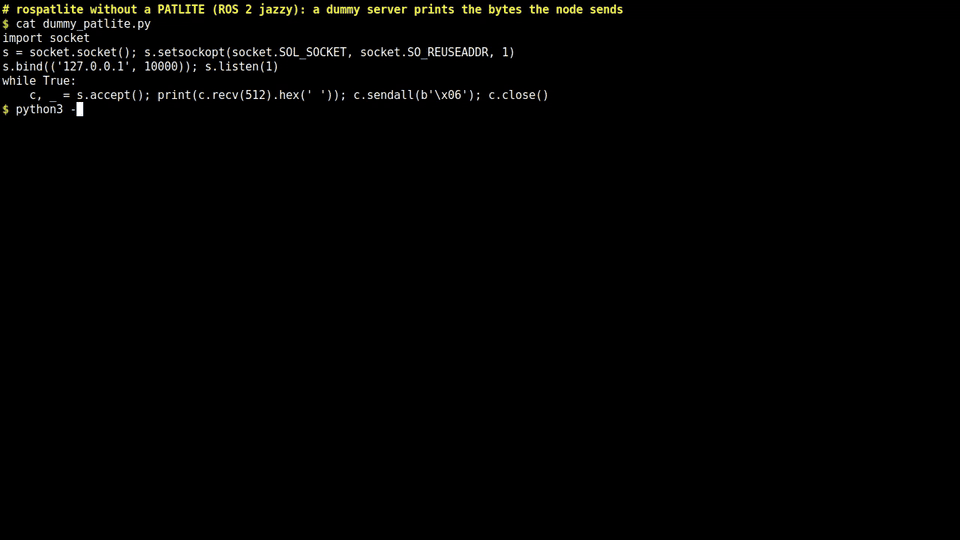

# rospatlite

A ROS driver of a network [PATLITE](https://www.patlite.jp/) signal tower (a LAN-controlled tower such as NH-SPL,
with its PHN command over TCP), to switch its red, yellow, green, blue and white lights and its buzzer from topics.

## Requirements

A PATLITE with a LAN interface, reachable over TCP (port `10000`, the default of the PHN command).

1. Connect the PATLITE with your computer directly.
2. Set the IP address of your computer to `192.168.10.x` (the PATLITE has `192.168.10.1` by default).
3. Open http://192.168.10.1/index.htm with your web browser and set up the network (IP address, and the PHN
   command on TCP port 10000). Please see [the manual](http://www.patlite.jp/product/nh-spl.html) for details.

## Usage

The launch file starts the node with the name `patlite`, so the topics are `/patlite/set/*`. Its argument `IP`
(default `10.68.0.10`, the address in JSK) is the address of the PATLITE.

### ROS 2

```bash
ros2 launch rospatlite patlite.launch.xml IP:=192.168.10.1
# or
ros2 run rospatlite patlite_node.py --ros-args -r __node:=patlite -p host:=192.168.10.1

ros2 topic pub --once /patlite/set/red std_msgs/msg/Int8 '{data: 1}'     # red light on
ros2 topic pub --once /patlite/set/yellow std_msgs/msg/Int8 '{data: 2}'  # yellow light flashes
ros2 topic pub --once /patlite/set/buzzer std_msgs/msg/Int8 '{data: 1}'  # buzzer on
ros2 topic pub --once /patlite/set/buzzer std_msgs/msg/Int8 '{data: 0}'  # buzzer off
```

### ROS 1

```bash
roslaunch rospatlite patlite.launch IP:=192.168.10.1

rostopic pub -1 /patlite/set/red std_msgs/Int8 1     # red light on
rostopic pub -1 /patlite/set/yellow std_msgs/Int8 2  # yellow light flashes
rostopic pub -1 /patlite/set/buzzer std_msgs/Int8 1  # buzzer on
rostopic pub -1 /patlite/set/buzzer std_msgs/Int8 0  # buzzer off
```

### Without a PATLITE

Each change of the state is sent as a new TCP connection to `~host:~port`, with the 6 bytes `58 58 53 00 00 06`
followed by the 6 states (red, yellow, green, blue, white, buzzer; `09` is "no change"). To see them without a
device, run a dummy server which prints them and answers ACK (`06`), and give `host:=127.0.0.1`:

```bash
python3 -c "
import socket
s = socket.socket(); s.setsockopt(socket.SOL_SOCKET, socket.SO_REUSEADDR, 1)
s.bind(('127.0.0.1', 10000)); s.listen(1)
while True:
    c, _ = s.accept(); print(c.recv(512).hex(' ')); c.sendall(b'\x06'); c.close()
"
```



## Interface

### `patlite_node.py`

Subscribed topics (`std_msgs/Int8`):

| Topic | Values |
|---|---|
| `~set/red`, `~set/yellow`, `~set/green`, `~set/blue`, `~set/white` | `0`: off, `1`: on, `2`: flash pattern 1, `3`: flash pattern 2 |
| `~set/buzzer` | `0`: off, `1` to `4`: buzzer patterns 1 to 4 |

A value other than `0` to `4` leaves the state as it is. The node sends the new state every 0.1 s when a message has come;
the other lights and the buzzer keep their states.

Parameters:

| Parameter | Type | Default | |
|---|---|---|---|
| `~host` | string | `10.68.0.10` | Host name or IP address of the PATLITE |
| `~port` | int | `10000` | TCP port of the PATLITE |
| `~timeout` | double | `0.5` | Timeout [s] of the socket |

`patlite.py` is the Python module of the protocol (`Patlite`, `PatliteState`); run alone, it turns on the red,
yellow and green lights of the PATLITE at `10.68.0.10`.
