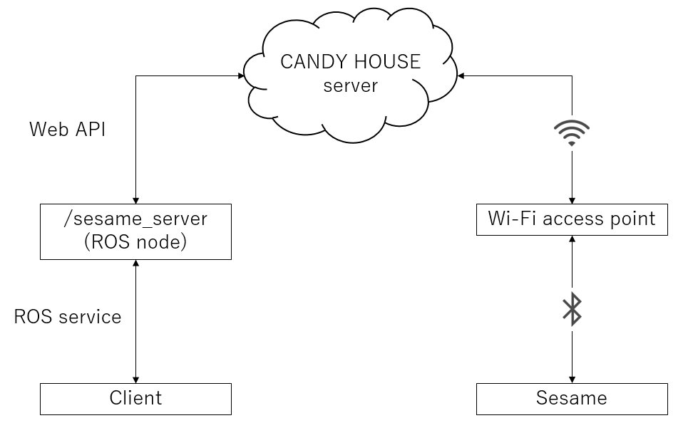

# sesame_ros

ROS API for the Sesame smart lock made by CANDY HOUSE, Inc. `sesame_server.py` provides services to get the status
of a Sesame and to lock, unlock and sync it through the Web API of CANDY HOUSE (`https://api.candyhouse.co/public`).



## Requirements

- A Sesame, reachable from the cloud of CANDY HOUSE (e.g. through its Wi-Fi access point), and the internet.
- An authorization token of the Web API: log in to the CANDY HOUSE Dashboard (https://my.candyhouse.co/) and create
  it there. You must be the owner of the Sesame to use the Web API; make sure that you can see the list of your
  Sesames on the dashboard. The token can be given as it is or as the path of a file whose first line is the token.
- Python package `requests`: on ROS 2 the system `python3-requests`; on ROS 1 it is installed into a virtualenv by
  `catkin_virtualenv` from `requirements.in.python2` / `requirements.in.python3.12` at build time.

## Usage

### ROS 2

```bash
colcon build --packages-up-to sesame_ros
source install/setup.bash
# list your Sesames (prints the JSON of https://api.candyhouse.co/public/sesames)
ros2 run sesame_ros list_sesames.py YOUR_AUTH_TOKEN   # or the path of a token file
# start the server
ros2 run sesame_ros sesame_server.py --ros-args -p auth_token:=YOUR_AUTH_TOKEN -p device_id:=YOUR_SESAMES_UUID
```

```bash
ros2 service call /sesame_server/get_status sesame_ros/srv/Status
ros2 service call /sesame_server/lock sesame_ros/srv/Command
ros2 service call /sesame_server/unlock sesame_ros/srv/Command
ros2 service call /sesame_server/force_sync sesame_ros/srv/Command
```

There is no launch file.

### ROS 1

```bash
rosrun sesame_ros list_sesames.py YOUR_AUTH_TOKEN
rosrun sesame_ros sesame_server.py _auth_token:=YOUR_AUTH_TOKEN _device_id:=YOUR_SESAMES_UUID
```

```bash
rosservice call /sesame_server/get_status
rosservice call /sesame_server/lock
rosservice call /sesame_server/unlock
rosservice call /sesame_server/force_sync
```

## Interface

### list_sesames.py

A script (not a node) listing your Sesames. Argument: `auth_token` (required), the token or the path of its file.

### sesame_server.py

The node is named `sesame_server`.

Services:

- `~get_status` (`sesame_ros/Status`): the `nickname`, `serial`, `device_id`, `battery`, `locked` and `responsive`
  of the Sesame.
- `~lock` (`sesame_ros/Command`): locks the Sesame and waits for the end of the task.
- `~unlock` (`sesame_ros/Command`): unlocks the Sesame and waits for the end of the task.
- `~force_sync` (`sesame_ros/Command`): makes the server of CANDY HOUSE update the status of the Sesame.

The response of `sesame_ros/Command` is `status` (`terminated` when the task ended), `successful` and `error`.

Parameters:

- `~auth_token` (string, required): the authorization token, or the path of a file of it.
- `~device_id` (string, default: none): the UUID of the Sesame.
- `~nickname` (string, default: none): the nickname of the Sesame.
  The Sesame is searched in your list first by `~device_id`, then by `~nickname`; if neither matches or is given,
  the first Sesame found is used.
- `~command_timeout` (int or float, default: `60`): the timeout [s] of `lock`, `unlock` and `force_sync`.

## Services

```
# sesame_ros/Status
---
string nickname
string serial
string device_id
int32 battery
bool locked
bool responsive
```

```
# sesame_ros/Command
---
string status
bool successful
string error
```
